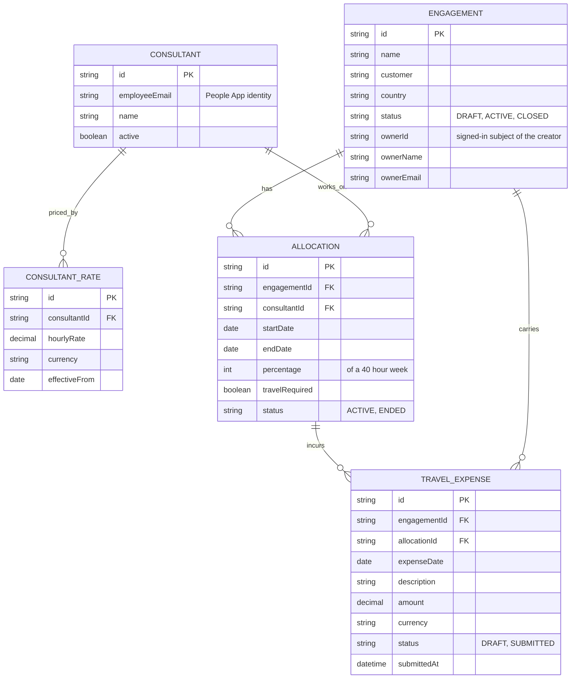

# Data model

Engagements are owned by an engagement manager. Consultants are People App employees with a history of hourly cost rates. An allocation places a consultant on an engagement for a period at a percentage of a 40-hour week, and travel expenses hang off allocations marked as requiring travel.

Employee details (department, country, reporting lead) are read live from People App and are not stored. Cost is computed on request from allocations and rates, never stored.